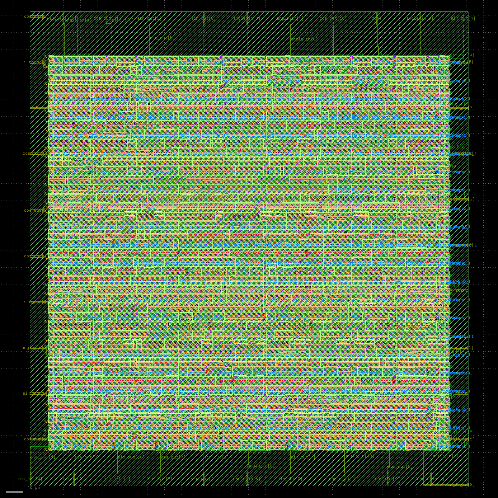

# CORDIC Word-Length Trade-off: Accuracy vs. Physical Design Cost

## Overview
This project implements a fixed-point CORDIC (COordinate Rotation DIgital Computer)
sine/cosine generator in Verilog and studies how fixed-point word length affects
both numerical accuracy and physical design cost (area, power, timing). CORDIC is
a shift-add-only algorithm widely used in aerospace/flight-control systems for
trigonometric computation (attitude and navigation calculations), directly
connecting to prior work on flight control systems.

Three word-length variants (8-bit, 12-bit, 16-bit) were implemented, each taken
through the full RTL-to-GDSII flow using OpenLane (Yosys, OpenROAD, Magic,
KLayout) on the SkyWater 130nm PDK, entirely in GitHub Codespaces (no local
EDA install).

## Design
- Algorithm: iterative rotation-mode CORDIC, 8 iterations
- Angle range: [-90°, +90°] (avoids quadrant-correction logic)
- Gain compensation via pre-scaled initial condition (x0 = K), keeping the
  entire datapath multiplier-free (pure shift-add)
- Same iteration count (8) held constant across all three word lengths, so
  word length is the only independent variable

## Experiment 1: Numerical Accuracy vs. Word Length
Verified against true sine/cosine values across 19 angles (-90° to +90°,
10° steps). Error reported as % of full-scale range.

| Word Length | Mean Error (% FS) | Max Error (cos) | Max Error (sin) |
|---|---|---|---|
| 8-bit  | 1.634 | 2.57  | 3.14   |
| 12-bit | 0.254 | 7.77  | 8.77   |
| 16-bit | 0.271 | 116.34| 116.34 |

**Finding:** Accuracy improves sharply from 8-bit to 12-bit, then **flattens
completely** from 12-bit to 16-bit. This indicates that at 8 iterations, the
CORDIC algorithm's inherent angle-approximation error (the residual left after
a finite number of shift-add steps) becomes the dominant error source beyond
12-bit — additional word length simply cannot help once this floor is reached.
This distinction between quantization error and angle-approximation error is
consistent with established CORDIC error-analysis literature (e.g. Kim, 2023,
*Error Analysis of CORDIC Processor with FPGA Implementation*, arXiv:2308.01025).

## Experiment 2: Physical Design Cost vs. Word Length
All three variants run at identical floorplan utilization (45%) and clock
period (10 ns) — word length is the only variable affecting these results.

| Word Length | Core Area (µm²) | Cell Count | Critical Path (ns) | Total Power (µW) |
|---|---|---|---|---|
| 8-bit  | 8,763  | 1,189 | 4.37 | 0.00124 |
| 12-bit | 13,935 | 1,850 | 4.94 | 0.00218 |
| 16-bit | 19,335 | 2,505 | 5.87 | 0.00314 |

**Finding:** Area, power, and critical path all scale roughly linearly (or
worse) with word length — 16-bit costs ~121% more area and ~153% more power
than 8-bit, with a ~34% longer critical path from longer carry chains in the
shift-add datapath.

## Conclusion: 12-bit is Pareto-Optimal for This Design
Combining both experiments: **16-bit costs substantially more area, power,
and timing than 12-bit, for no measurable accuracy improvement**, since the
accuracy bottleneck at 8 iterations is algorithmic (angle-approximation
error), not word-length-driven. For this iteration count, 12-bit fixed-point
is the recommended operating point — 8-bit trades meaningful accuracy for a
smaller design, while 16-bit only adds cost.

This result depends on iteration count: a design using more than 8 iterations
would likely see the accuracy floor shift, potentially making 16-bit
worthwhile again — a natural direction for further exploration.

## Physical Layout (12-bit variant)

Rendered from the final GDS using KLayout in headless mode
(`QT_QPA_PLATFORM=offscreen`).

## Tools & Environment
- **Flow:** OpenLane v1.0.2 (Yosys, OpenROAD, Magic, KLayout, SkyWater 130nm PDK)
- **Environment:** GitHub Codespaces (browser-based, no local install)
- **RTL verification:** EDA Playground (Icarus Verilog)

## Repository Contents
- `designs/cordic{8,12,16}/src/*.v` — parameterized CORDIC RTL, one per word length
- `designs/cordic{8,12,16}/config.json` — OpenLane configs (identical utilization/clock)
- `designs/cordic{8,12,16}/runs/*/reports/metrics.csv` — PPA metrics per variant
- `designs/cordic12/runs/*/results/final/gds/cordic12.gds` — final GDS (12-bit)
- `cordic12_layout.png` — rendered layout image
